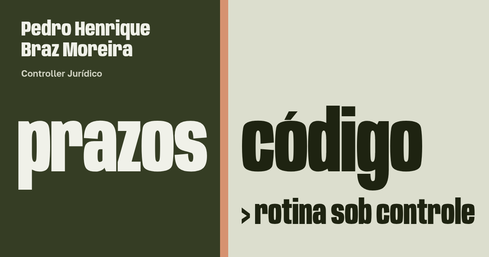

# Currículo

The CV of Pedro Henrique Braz Moreira, in Portuguese and English:
**<https://lizindev.github.io/Curriculo/>**
([English](https://lizindev.github.io/Curriculo/?lang=en))



One static page with no framework and no build step. The idea is a shell pipe: the dark
half is what comes in, the light half is what comes out, and the clay pipe between them
is the tool. Three tools run in the page, with fictitious data and nothing sent anywhere:
a [TarefasLegalOne](https://github.com/LizinDev/TarefasLegalOne) batch that can be stopped
and resumed, a reader for Brazilian court case numbers, and
[pdf-splitter](https://github.com/LizinDev/pdf-splitter).

## Files

| Path | What it is |
| --- | --- |
| `index.html` | the page, with the Portuguese text |
| `i18n.js` | the English text, keyed like the HTML |
| `script.js` | language switch, the three tools, search and scrolling |
| `tokens.css` | colors, fonts, type scale and measures |
| `styles.css` | the screen layout |
| `print.css` | how the page itself prints |
| `cv/` | the text and layout of the one-page PDFs |
| `fonts/` | Anybody, Golos Text and Azeret Mono, with their OFL licenses |
| `og-image.png`, `og-template.html` | the link-preview image and the page it was rendered from |
| `tools/gerar-pdf.py` | makes both PDFs and stops unless each fits one page |
| `tools/verificar-i18n.py` | checks that both languages have the same keys |
| `tools/verificar-competencias.py` | checks that the skills table matches the text of the CV |
| `tools/verificar-pdf.py` | checks that each PDF has the same facts as the page, on one page |
| `tools/testar-verificadores.py` | breaks copies of the repository and expects each check to notice |

All of them but the PDF generator run in CI on every push.

## Preview locally

```bash
python3 -m http.server 8000
```

Then open <http://localhost:8000>. After editing the CV:

```bash
python3 tools/verificar-i18n.py
python3 tools/verificar-competencias.py
python3 tools/gerar-pdf.py       # needs Chromium and poppler
python3 tools/verificar-pdf.py   # needs poppler
```

## License

The code (HTML structure, CSS, JavaScript and the tools) is under the
[MIT License](LICENSE). The fonts are under the SIL Open Font License, in `fonts/`. The CV
itself, meaning its text, personal details and the PDFs, is not covered: all rights reserved.
